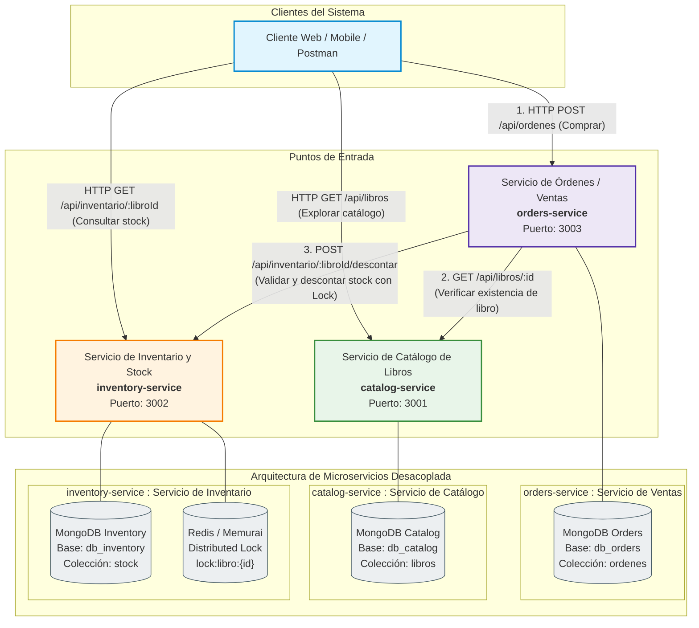

# Trabajo Práctico N° 5: De API REST a Microservicios
**Licenciatura en Sistemas de Información - Programación Distribuida**  
**Universidad Champagnat**

---

## 1. Carátula y Datos del Grupo

* **Fecha de Entrega:** Octubre 2026
* **Materia:** Programación Distribuida
* **Grupo:** Grupo N° 1
* **Integrantes del Grupo 1:**
  * **Joel Aisama** (DNI: 44.537.211) - aisamajoel@gmail.com - GitHub: [@aisamajoel-tech](https://github.com/aisamajoel-tech)
  * **Bautista Navarro** (DNI: 45.722.618) - bautista.navarro@uch.edu.ar - GitHub: [@BautiNavarro](https://github.com/BautiNavarro)
  * **Candela Aguilar** - candeaguilar@uch.edu.ar - GitHub: [@candeaguilar](https://github.com/candeaguilar)
  * **Delfina Ibáñez** - delfinaibanez@uch.edu.ar - GitHub: [@delfinaibanez](https://github.com/delfinaibanez)
* **Docentes de Cátedra:**
  * Prof. Adriel Álvarez (`alvarezadriel@uch.edu.ar`)
  * Prof. Edgardo Cortez (`cortezedgardo@uch.edu.ar`)
* **Repositorio Único del Proyecto:** `https://github.com/aisamajoel-tech/Trabajo-Integrador-Programacion-Distribuida-Grupo-1` *(Reemplazar con la URL remota definitiva)*

---

## 2. Preparación del Entorno Colaborativo con Git

El proyecto adopta una modalidad de **Repositorio Único y Evolutivo**. Este repositorio albergará la totalidad de las etapas del trabajo integrador (TP5 y posteriores), garantizando la trazabilidad histórica del desarrollo mediante ramas, commits atómicos, pull requests y etiquetas de versión.

### 2.1 Identidad y Colaboración
Cada integrante del grupo cuenta con Git configurado con su nombre y dirección de correo institucional:
```bash
git config --global user.name "Nombre Apellido"
git config --global user.email "correo@ejemplo.com"
```
Los dos docentes de la cátedra han sido invitados formalmente al repositorio en calidad de colaboradores:
* `alvarezadriel@uch.edu.ar`
* `cortezedgardo@uch.edu.ar`

### 2.2 Estrategia de Ramificación (Branching Strategy)
Se ha implementado un flujo de trabajo basado en ramas temáticas donde la rama `main` contiene únicamente código estable e integrado mediante revisiones de pares (Pull Requests):
* `main`: Rama de producción y estabilidad.
* `feature/catalog-service`: Desarrollo del límite y especificación de catálogo.
* `feature/inventory-service`: Lógica de inventario, stock y exclusión mutua distribuida.
* `feature/orders-service`: Orquestación de compras y pedidos.
* `docs/arquitectura`: Elaboración de matrices, diagramas y especificación técnica del TP5.
* `fix/*`: Correcciones puntuales sobre módulos existentes.

### 2.3 Política de Commits y Pull Requests
Los mensajes de commit se adhieren a la convención semántica de cambios concretos:
* `Add initial shared repository`: Subida del monolito funcional previo.
* `Document service boundaries`: Especificación de límites y contratos de los servicios.
* `Extract inventory responsibility`: Aislamiento del dominio de existencias y locks.
* `Add service communication`: Diseño de las interfaces públicas HTTP/REST.
* `Fix stock validation`: Ajustes de validación de concurrencia y consistencia.

Cada Pull Request integra un resumen del problema abordado, archivos modificados y la evidencia de pruebas locales realizadas.

### 2.4 Identificación de Entregas mediante Tags
Para delimitar la versión aprobada correspondiente al TP5 dentro del historial continuo del repositorio, se genera la etiqueta:
```bash
git tag tp5-entrega
git push origin tp5-entrega
```

### 2.5 Política de Seguridad e Información Sensible (.gitignore)
El archivo `.gitignore` del proyecto asegura que ningún secreto, token, clave privada o carpeta de dependencias sea versionado:
```
node_modules/
.env
*.log
certs/*.key
certs/*.pem
!certs/cert.pem
```
La aplicación base provee un archivo `.env.example` con las variables de configuración necesarias debidamente comentadas y sin credenciales reales.

---

## 3. Análisis de la Aplicación Existente (Monolito Base)

### 3.1 Descripción del Punto de Partida
La versión funcional de partida corresponde a la API REST desarrollada en Node.js + Express con persistencia en **MongoDB (Mongoose)**, exclusión mutua mediante **Redis/Memurai**, logging con **Winston** (rotación diaria) y documentación de endpoints con **OpenAPI/Swagger**.

Dicha versión se encuentra almacenada de manera íntegra y reproducible en la carpeta `/app-base` del repositorio.

### 3.2 Inventario de Funcionalidades y Endpoints Actuales

A continuación se detalla el relevamiento técnico de las operaciones disponibles en la versión previa:

| Funcionalidad / Endpoint | Responsabilidad Actual | Datos Utilizados | Dependencias |
| :--- | :--- | :--- | :--- |
| `GET /api/libros` | Listar la totalidad de libros registrados con orden cronológico descendente. | Colección `libros` de MongoDB (`titulo`, `autor`, `año`, `stock`, `genero`, `isbn`). | Conexión activa a MongoDB / Driver Mongoose; Logger Winston. |
| `GET /api/libros/:id` | Consultar la ficha detallada de un libro individual mediante su ObjectId. | Parámetro `id` de ruta; Documento `Libro` en MongoDB. | Driver Mongoose (validación ObjectId); MongoDB; Logger. |
| `POST /api/libros` | Dar de alta un nuevo libro aplicando validaciones de esquema e integridad (ISBN único). | Cuerpo JSON: `titulo`, `autor`, `año`, `stock`, `genero`, `isbn`. | Mongoose Schema (validaciones); Índice único de MongoDB; Winston. |
| `PUT /api/libros/:id` | Actualizar integralmente los atributos bibliográficos y/o el stock de un libro existente. | Parámetro `id` de ruta; Campos JSON a actualizar. | Validador Mongoose; MongoDB; Logger Winston. |
| `DELETE /api/libros/:id` | Dar de baja permanente un libro de la base de datos. | Parámetro `id` de ruta. | Mongoose `findByIdAndDelete`; MongoDB; Winston. |
| `POST /api/libros/:id/comprar-inseguro` | Simular una compra sin exclusión mutua introduciendo retardo artificial para evidenciar la condición de carrera (*Check-Then-Act*). | Parámetro `id`; Cabecera `x-client-id`; Campo `stock` del documento en MongoDB. | Variable `ARTIFICIAL_DELAY_MS`; Persistencia MongoDB; Logger. |
| `POST /api/libros/:id/comprar` | Procesar una compra concurrente protegida con Lock Distribuido en Redis/Memurai para garantizar exclusión mutua sobre el stock. | Parámetro `id`; Cabecera `x-client-id`; Clave `lock:libro:{id}` en Redis; Campo `stock` en MongoDB. | `lockService.js` (Redis client); Scripts Lua; Persistencia MongoDB; Winston. |
| `GET /api/libros/:id/lock-status` | Consultar el estado operativo, tiempo restante de vida (TTL) y titular del lock en Redis. | Parámetro `id`; Clave `lock:libro:{id}` en Redis. | Conexión Redis/Memurai. |
| `GET /api-docs` | Servir la documentación interactiva OpenAPI 3.0 mediante Swagger UI. | Especificaciones JSDoc y swagger.json. | `swagger-ui-express`, `swagger-jsdoc`. |

---

## 4. Identificación de Responsabilidades del Negocio

Al analizar funcionalmente la aplicación existente, se distinguen tres grandes grupos de responsabilidades que actualmente se encuentran forzadas dentro de un único componente:

### Grupo Funcional 1: Gestión de Catálogo Bibliográfico
1. **¿Qué problema o necesidad del sistema resuelve?**  
   Resuelve la catalogación, clasificación y divulgación pública de las obras disponibles, permitiendo a lectores y administradores conocer títulos, autores, fechas de edición, géneros literarios e identificadores normalizados (ISBN).
2. **¿Qué operaciones realiza?**  
   Búsqueda de libros, filtrado, consulta de detalles de una obra, alta de nuevos ejemplares al catálogo, modificación de datos editoriales y desindexación de títulos obsoletos.
3. **¿Qué reglas de negocio contiene?**  
   - Los títulos no pueden ser vacíos ni superar los 150 caracteres.
   - El autor es obligatorio.
   - El año de publicación debe estar acotado entre el 1000 y el año en curso + 1.
   - El código ISBN debe cumplir con el formato internacional normalizado (10 o 13 dígitos) y poseer unicidad estricta.
   - El género debe pertenecer a una lista controlada de categorías permitidas.
4. **¿Qué información necesita para trabajar?**  
   Metadatos descriptivos de la obra suministrados por editores o administradores.
5. **¿Qué información crea o modifica?**  
   Crea y mantiene registros bibliográficos y sus metadatos descriptivos.
6. **¿Qué otras funcionalidades necesita conocer?**  
   Ninguna. El catálogo representa el núcleo informativo del producto y posee total autonomía ontológica.
7. **¿Qué cambios funcionales suelen ocurrir juntos?**  
   Modificaciones en políticas editoriales, enriquecimiento de sinopsis, incorporación de nuevas etiquetas temáticas o cambios en la categorización de géneros.
8. **¿Podría evolucionar de manera independiente del resto de la aplicación?**  
   **Sí.** El catálogo no necesita enterarse de compras, pagos, clientes ni de las bodegas físicas donde se almacena el papel.

---

### Grupo Funcional 2: Gestión de Inventario y Control de Stock
1. **¿Qué problema o necesidad del sistema resuelve?**  
   Resuelve el control riguroso de existencias físicas disponibles para entrega, evitando quiebres de stock, sobreventas y bloqueos de concurrencia cuando múltiples compradores compiten por las últimas unidades.
2. **¿Qué operaciones realiza?**  
   Consulta de disponibilidad, reserva de existencias, deducción efectiva de stock, reabastecimiento (ingreso de mercadería) y coordinación de exclusión mutua para modificaciones concurrentes.
3. **¿Qué reglas de negocio contiene?**  
   - El stock es un entero mayor o igual a 0 (nunca puede admitirse un valor negativo).
   - Dos solicitudes concurrentes jamás pueden vender la misma unidad física (*Consistencia Estricta* / Exclusión Mutua con Redis Lock).
   - Toda adquisición de lock debe tener un tiempo de expiración (TTL) acotado para impedir interbloqueos (*deadlocks*).
   - La liberación del lock exige verificación atómica de propiedad mediante scripts Lua.
4. **¿Qué información necesita para trabajar?**  
   El identificador del producto (`libroId`) y la cantidad de unidades demandadas o reabastecidas.
5. **¿Qué información crea o modifica?**  
   El saldo numérico de existencias disponibles y reservadas, y las claves transitorias de lock en memoria.
6. **¿Qué otras funcionalidades necesita conocer?**  
   Solo requiere validar que el identificador del producto exista en el sistema de catálogo antes de crear un nuevo casillero de stock.
7. **¿Qué cambios funcionales suelen ocurrir juntos?**  
   Estrategias de aprovisionamiento, reglas de stock de seguridad, políticas de exclusión mutua o migración a almacenes de alta velocidad en memoria.
8. **¿Podría evolucionar de manera independiente del resto de la aplicación?**  
   **Sí.** Las decisiones sobre almacenamiento físico y algoritmos de concurrencia pertenecen exclusivamente al dominio de existencias y logística.

---

### Grupo Funcional 3: Gestión de Ventas y Órdenes de Compra
1. **¿Qué problema o necesidad del sistema resuelve?**  
   Resuelve el ciclo de vida comercial: la intención de compra del cliente, la orquestación del pedido, el comprobante transaccional, el estado de la venta y la trazabilidad histórica de pedidos.
2. **¿Qué operaciones realiza?**  
   Creación de orden de compra, validación integral de la operación con los servicios asociados, cálculo de importes, emisión de comprobantes y consulta del historial de órdenes por cliente.
3. **¿Qué reglas de negocio contiene?**  
   - Una compra solo puede confirmarse si el libro está catalogado y si el servicio de inventario pudo reservar el stock solicitado de manera exitosa.
   - Cada orden debe contar con un identificador único, un cliente emisor, fecha/hora y un estado transaccional (`PENDIENTE`, `CONFIRMADA`, `RECHAZADA_SIN_STOCK`, `FALLIDA`).
   - Si la reserva de inventario es rechazada por falta de stock o conflicto de concurrencia, la orden debe registrarse como no concretada y el cliente debe recibir una respuesta explicativa.
4. **¿Qué información necesita para trabajar?**  
   Identificador del cliente, identificador del libro y cantidad deseada.
5. **¿Qué información crea o modifica?**  
   Genera documentos de Órdenes de Compra y actualiza sus estados a lo largo del flujo comercial.
6. **¿Qué otras funcionalidades necesita conocer?**  
   Necesita consultar la interfaz pública de Catálogo (para verificar la existencia del libro) y la interfaz pública de Inventario (para solicitar la reserva y deducción de stock).
7. **¿Qué cambios funcionales suelen ocurrir juntos?**  
   Incorporación de pasarelas de pago, promociones comerciales, generación de facturación electrónica o integración con despachos.
8. **¿Podría evolucionar de manera independiente del resto de la aplicación?**  
   **Sí.** El proceso de venta comercial puede incorporar cuotas, descuentos o múltiples productos sin alterar la ficha del libro ni la estructura de bodegas de inventario.

---

## 5. Identificación de Acoplamientos en la Aplicación Actual

A continuación se presentan tres situaciones concretas del sistema actual donde el acoplamiento debilita la mantenibilidad, escalabilidad y resiliencia:

| Caso | Acoplamiento Detectado | Problema Generado | Propuesta de Desacople |
| :---: | :--- | :--- | :--- |
| **1** | **Acoplamiento de Esquema de Datos (Catálogo e Inventario fusionados en `Libro.js`).**<br/>El modelo de MongoDB almacena en un solo documento los metadatos bibliográficos (`titulo`, `autor`, `isbn`) junto al contador transaccional `stock`. | Cada actualización de datos editoriales compite por el mismo registro de base de datos con una operación de compra. Un bibliotecario corrigiendo una fe de erratas en el título puede generar contención o ser bloqueado por clientes comprando unidades. Además, no es posible escalar el almacenamiento de inventario de forma independiente. | **Separación en dos modelos y almacenes independientes:**<br/>El servicio de catálogo mantiene únicamente los metadatos bibliográficos. El servicio de inventario pasa a gestionar su propia colección de existencias (`stock`), indexada por `libroId`. Ambos componentes se comunican exclusivamente vía interfaces REST públicas. |
| **2** | **Ausencia del Dominio de Órdenes y Venta Invasiva.**<br/>El endpoint `POST /api/libros/:id/comprar` realiza la mutación destructiva del stock en el propio recurso libro sin crear una entidad ni registro de pedido. | No queda registro histórico de quién compró, cuántas unidades, cuándo, ni en qué estado quedó la transacción. No existe trazabilidad comercial ni posibilidad de emitir comprobantes de venta o implementar auditorías. El recurso "libro" asume responsabilidades transaccionales comerciales que le son ajenas. | **Creación del Microservicio de Órdenes (`orders-service`):**<br/>La acción de compra es promovida a una entidad de primer orden (`OrdenDeCompra`). El servicio de órdenes coordina la solicitud, valida la existencia con el catálogo, descuenta el stock mediante el servicio de inventario y persiste la transacción de forma inmutable. |
| **3** | **Acoplamiento de Disponibilidad de Infraestructura.**<br/>En `routes/libros.js`, el controlador monolítico importa y depende de manera sincrónica y estricta tanto del cliente Mongoose/MongoDB como del cliente Redis (`lockService.js`). | Si la instancia de Redis/Memurai se interrumpe temporalmente, una simple consulta de lectura del catálogo de libros (`GET /api/libros`) puede verse degradada o arrojar errores 500 debido a fallos globales en el mismo proceso Node.js. Toda la aplicación cae ante la falla de un subsistema específico. | **Aislamiento de Infraestructura por Microservicio:**<br/>Redis/Memurai queda confinado exclusivamente al interior del `inventory-service`. El `catalog-service` opera de manera 100% aislada con su propia base MongoDB. Si Redis experimenta una degradación, los lectores pueden continuar consultando el catálogo sin enterarse de la interrupción. |

---

## 6. Propuesta de Arquitectura en Microservicios

En concordancia con el principio de responsabilidad única (*Single Responsibility Principle*) a nivel arquitectónico y los límites de contexto (*Bounded Contexts* de Domain-Driven Design), se define una arquitectura conformada por **tres microservicios independientes**:

```
[ Cliente / Postman ]
          │
          │ HTTP / REST
          ▼
┌───────────────────────────────┐
│        orders-service         │  Puerto: 3003
│  (Gestión de Órdenes/Ventas)  │  BD: db_orders (MongoDB)
└──────────────┬────────────────┘
               │
       ┌───────┴────────────────┐
  HTTP │                   HTTP │
       ▼                        ▼
┌───────────────────────┐  ┌──────────────────────────────────────┐
│    catalog-service    │  │          inventory-service           │
│ (Catálogo Bibliogr.)  │  │   (Control de Stock y Exclusión)     │
│ Puerto: 3001          │  │ Puerto: 3002                         │
│ BD: db_catalog (Mongo)│  │ BD: db_inventory (Mongo) + Redis DB │
└───────────────────────┘  └──────────────────────────────────────┘
```

---

### 6.1 Fichas de Definición de cada Microservicio

#### Ficha N° 1: `catalog-service`
* **Nombre:** `catalog-service` (Servicio de Catálogo Bibliográfico).
* **Responsabilidad Principal:** Centralizar y gestionar la información bibliográfica y documental de las obras literarias que componen el catálogo del sistema.
* **Operaciones:**
  * Publicar el listado de libros con ordenamiento y filtros.
  * Consultar el detalle de un libro por su identificador único.
  * Registrar nuevas obras con validaciones sintácticas y de unicidad de ISBN.
  * Modificar datos editoriales (título, autor, año, género, ISBN).
  * Dar de baja obras del catálogo.
* **Reglas de Negocio:**
  * Título obligatorio (1 a 150 caracteres).
  * Autor obligatorio (1 a 100 caracteres).
  * Año de edición válido (1000 a año actual + 1).
  * Género restringido a lista controlada (`Ficción`, `Novela`, `Historia`, `Ciencia`, `Terror`, `Fantasía`, `Otro`).
  * Validación estricta y unicidad del código ISBN a nivel de persistencia.
* **Datos Propios:** Documentos de la colección `libros` (`id`, `titulo`, `autor`, `año`, `genero`, `isbn`, `createdAt`, `updatedAt`). **No contiene datos de stock**.
* **Endpoints:**
  * `GET /api/libros` (Existente migrado).
  * `GET /api/libros/:id` (Existente migrado).
  * `POST /api/libros` (Existente migrado - sin campo stock).
  * `PUT /api/libros/:id` (Existente migrado - sin campo stock).
  * `DELETE /api/libros/:id` (Existente migrado).
* **Dependencias:** Ninguna (servicio base autónomo).
* **Fuera de Alcance:**
  * No gestiona existencias ni depósitos.
  * No administra precios ni pasarelas de pago.
  * No procesa compras ni transacciones de clientes.
* **Justificación:** Maximiza la cohesión de los metadatos bibliográficos y elimina la contención de base de datos entre lecturas públicas y transacciones de compra.

---

#### Ficha N° 2: `inventory-service`
* **Nombre:** `inventory-service` (Servicio de Inventario y Control de Stock).
* **Responsabilidad Principal:** Custodiar la integridad, disponibilidad y consistencia de las existencias físicas de las obras, garantizando exclusión mutua distribuida en compras concurrentes.
* **Operaciones:**
  * Consultar el stock disponible de un libro.
  * Validar y descontar stock de forma atómica bajo condiciones de alta concurrencia.
  * Reabastecer stock (incrementar unidades disponibles).
  * Inicializar el registro de existencias para un libro recién catalogado.
* **Reglas de Negocio:**
  * El stock nunca puede ser menor a 0.
  * Exclusión mutua obligatoria: solo una solicitud a la vez puede ejecutar la sección crítica de validación y decremento sobre un mismo `libroId` (garantizado con Redis Distributed Lock).
  * Todo lock debe contar con TTL (5000 ms) para evitar interbloqueos ante caídas del servidor.
  * La liberación del lock se realiza exclusivamente con token criptográfico del propietario mediante script Lua.
  * Si el recurso se encuentra bloqueado, responde HTTP 409 Conflict de manera controlada.
* **Datos Propios:** Colección `stock` en base de datos `db_inventory` (`libroId`, `stockDisponible`, `stockReservado`, `ultimaActualizacion`) y claves de lock volátiles en Redis/Memurai (`lock:libro:{id}`).
* **Endpoints:**
  * `GET /api/inventario/:libroId` (Nuevo).
  * `POST /api/inventario/:libroId/descontar` (Evolución de `/comprar` encapsulada en inventario).
  * `POST /api/inventario/:libroId/reponer` (Nuevo).
  * `GET /api/inventario/:libroId/lock-status` (Existente migrado a inventario).
* **Dependencias:** Requiere el servicio Redis/Memurai para la exclusión mutua. En inicialización de stock, valida la existencia del `libroId` contra `catalog-service`.
* **Fuera de Alcance:**
  * No conoce títulos, autores ni detalles bibliográficos (solo opera con `libroId`).
  * No emite órdenes de compra ni gestiona clientes.
* **Justificación:** Aísla la complejidad de concurrencia y los mecanismos de bloqueo en memoria dentro de un componente especializado de alta velocidad, evitando que caídas de Redis afecten al resto del sistema.

---

#### Ficha N° 3: `orders-service`
* **Nombre:** `orders-service` (Servicio de Gestión de Ventas y Órdenes).
* **Responsabilidad Principal:** Orquestar el flujo integral de venta, emitiendo comprobantes de compra inmutables y coordinando la validación del producto y la reserva de existencias.
* **Operaciones:**
  * Procesar una nueva solicitud de compra enviada por un cliente.
  * Generar y persistir una orden de compra con estado trazable.
  * Consultar una orden específica por su identificador.
  * Consultar el histórico de órdenes asociadas a un cliente.
* **Reglas de Negocio:**
  * Toda orden debe identificar al cliente emisor (`clienteId`), el producto (`libroId`) y la cantidad solicitada.
  * La orden no puede confirmarse si el libro no existe en el catálogo.
  * La orden se cancela inmediatamente con código de error apropiado si el servicio de inventario rechaza el descuento por falta de stock (HTTP 400) o por recurso bloqueado (HTTP 409).
  * Las órdenes confirmadas son inmutables para fines de auditoría comercial.
* **Datos Propios:** Colección `ordenes` en base de datos `db_orders` (`id`, `clienteId`, `libroId`, `cantidad`, `estado`, `fechaCreacion`, `detalles`).
* **Endpoints:**
  * `POST /api/ordenes` (Nuevo punto de entrada principal para compras).
  * `GET /api/ordenes/:id` (Nuevo).
  * `GET /api/ordenes/cliente/:clienteId` (Nuevo).
* **Dependencias:**
  * Invoca a `catalog-service` mediante `GET /api/libros/:id` para validar existencia y obtener metadatos.
  * Invoca a `inventory-service` mediante `POST /api/inventario/:libroId/descontar` para asegurar existencias.
* **Fuera de Alcance:**
  * No descuenta stock directamente ni toca bases de datos de otros servicios.
  * No almacena información bibliográfica de los libros más allá de capturar una instantánea de datos requerida para el comprobante.
* **Justificación:** Otorga una entidad de primer orden al proceso de compra, permitiendo auditoría, estados transaccionales y desacoplando al cliente final de los detalles internos de inventario o catálogo.

---

### 6.2 Tabla General de Responsabilidades Consolidadas

| Microservicio | Responsabilidad | Datos Administrados | Funciones Principales | Dependencias |
| :--- | :--- | :--- | :--- | :--- |
| **`catalog-service`** | Gestión integral del catálogo bibliográfico y metadatos literarios. | Obras literarias: `titulo`, `autor`, `año`, `genero`, `isbn`. | Altas, bajas, modificaciones y consultas del catálogo de libros. | Ninguna. |
| **`inventory-service`** | Control de existencias físicas y exclusión mutua distribuida de stock. | Balances de stock (`libroId`, `stockDisponible`) y claves de lock en Redis. | Verificación de disponibilidad, deducción concurrente protegida y reposición de stock. | Redis/Memurai (para locks). |
| **`orders-service`** | Orquestación del proceso de ventas y trazabilidad comercial. | Órdenes de compra: `clienteId`, `libroId`, `cantidad`, `estado`, `timestamp`. | Recepción de pedidos, orquestación inter-servicio y emisión de comprobantes inmutables. | `catalog-service` y `inventory-service`. |

---

## 7. Propiedad y Acceso a los Datos (Data Ownership)

Siguiendo el patrón arquitectónico **Database-per-Service**, cada microservicio es el propietario exclusivo de su esquema y base de datos física o lógica. Ningún servicio puede consultar ni modificar directamente las tablas o colecciones de otro servicio.

### Matriz de Propiedad de Datos

| Dato / Recurso | Servicio Propietario | Quién Puede Consultarlo | Quién Puede Modificarlo | Forma de Acceso Permitida |
| :--- | :--- | :--- | :--- | :--- |
| **Metadatos del Libro** (`titulo`, `autor`, `año`, `genero`, `isbn`) | `catalog-service` | Todos los servicios (`orders-service`, clientes externos). | Únicamente administradores mediante `catalog-service`. | Interfaz REST pública: `GET /api/libros/:id` |
| **Existencias de Stock** (`stockDisponible`, `stockReservado`) | `inventory-service` | `orders-service` y clientes autorizados. | Exclusivamente `inventory-service` en sus endpoints internos. | Interfaz REST pública: `POST /api/inventario/:libroId/descontar` |
| **Locks Distribuidos** (`lock:libro:{id}`) | `inventory-service` | `inventory-service` (consulta de estado para diagnóstico). | Exclusivamente el proceso interno de `inventory-service`. | Acceso nativo mediante cliente Redis con clave privada y script Lua. |
| **Órdenes de Compra** (`ordenId`, `clienteId`, `estado`, `fecha`) | `orders-service` | Clientes que emitieron la orden y personal de auditoría. | Únicamente `orders-service` durante el ciclo de vida del pedido. | Interfaz REST pública: `GET /api/ordenes/:id` |

---

## 8. Comunicación entre Microservicios

Para la interacción entre servicios se utiliza comunicación síncrona mediante el protocolo **HTTP/REST**, intercambiando cargas útiles en formato JSON.

### 8.1 Matriz de Comunicaciones HTTP/REST

| Origen | Destino | Necesidad de Negocio | Método / Endpoint | Datos Intercambiados | Respuesta Esperada |
| :--- | :--- | :--- | :--- | :--- | :--- |
| **Cliente** | `orders-service` | Iniciar un pedido de compra. | `POST /api/ordenes` | **Body:** `{ libroId, cantidad, clienteId }` | `201 Created` con detalle de la orden generada. |
| **`orders-service`** | `catalog-service` | Verificar que el libro exista y obtener datos para la orden. | `GET /api/libros/:id` | **Path:** `id`<br/>**Headers:** Correlación de traza | `200 OK` con datos del libro, o `404 Not Found` si no existe. |
| **`orders-service`** | `inventory-service` | Solicitar la reserva y deducción de stock bajo exclusión mutua. | `POST /api/inventario/:libroId/descontar` | **Path:** `libroId`<br/>**Body:** `{ cantidad, clienteId }`<br/>**Header:** `x-request-id` | `200 OK` si el stock fue descontado con éxito.<br/>`400 Bad Request` si no hay stock suficiente.<br/>`409 Conflict` si el recurso está bloqueado. |
| **Cliente** | `catalog-service` | Explorar el catálogo bibliográfico público. | `GET /api/libros` | Ninguno (o parámetros de consulta para filtros). | `200 OK` con array JSON de libros. |
| **Cliente** | `inventory-service` | Consultar disponibilidad de un libro antes de comprar. | `GET /api/inventario/:libroId` | **Path:** `libroId` | `200 OK` con `{ libroId, stockDisponible }`. |

### 8.2 Análisis Crítico de las Comunicaciones Propuestas
* **¿Es realmente necesario que un servicio conozca al otro?**  
  Sí, `orders-service` actúa como el orquestador del caso de uso de negocio (Saga orquestada simple). `catalog-service` e `inventory-service` no conocen a `orders-service` ni se conocen entre sí, manteniendo el principio de dependencias unidireccionales.
* **¿Se está duplicando una regla de negocio que debería tener un único propietario?**  
  No. La validación del stock y la exclusión mutua pertenecen al 100% a `inventory-service`. `orders-service` no verifica stock por su cuenta ni replica fórmulas; simplemente interpreta el código HTTP resultante (200, 400 o 409).
* **¿La información solicitada podría pertenecer al servicio que la necesita?**  
  No. Si `orders-service` guardara el stock, se volvería a caer en el acoplamiento monolítico previo y se violaría la propiedad de los datos de inventario.
* **¿El contrato entre servicios puede expresarse sin conocer detalles internos de implementación?**  
  Sí. `inventory-service` expone `POST /descontar` recibiendo `{ cantidad }` y respondiendo éxito o conflicto. `orders-service` desconoce por completo si `inventory-service` utiliza Redis, Memurai, Semáforos o transacciones ACID relacionales.
* **¿Qué ocurre si el servicio destino no se encuentra disponible?**  
  Si `catalog-service` o `inventory-service` no responden (por timeout o caída), `orders-service` captura el error y responde al cliente con un código `503 Service Unavailable`, informando que la compra no pudo ser procesada sin dejar pedidos inconsistentes ni datos a medio escribir.

---

## 9. Trazado de Casos de Uso del Sistema

### Caso de Uso A: Consulta y Exploración de Catálogo
* **Actor:** Cliente / Navegador web.
* **Objetivo:** Visualizar el catálogo de libros y consultar detalles de una obra sin interactuar con los servicios transaccionales.

```
Cliente                     catalog-service               MongoDB (Catalog)
   │                               │                              │
   │ 1. GET /api/libros            │                              │
   ├──────────────────────────────>│                              │
   │                               │ 2. db.libros.find()          │
   │                               ├─────────────────────────────>│
   │                               │ 3. Retorna lista de libros   │
   │                               │<─────────────────────────────┤
   │ 4. HTTP 200 OK [JSON libros]  │                              │
   │<──────────────────────────────┤                              │
```
1. El cliente efectúa una petición `GET /api/libros` hacia el `catalog-service`.
2. El servicio consulta su colección local en MongoDB sin requerir locks ni consumir recursos de inventario.
3. El resultado se retorna de forma inmediata con alta disponibilidad y bajo consumo de red.

---

### Caso de Uso B: Proceso de Compra Concurrente con Exclusión Mutua
* **Actor:** Cliente / Aplicación compradora.
* **Objetivo:** Ejecutar la compra de un libro asegurando consistencia estricta en el stock mediante el coordinador de locks Redis.

```
Cliente            orders-service          catalog-service        inventory-service            Redis / Memurai
   │                      │                       │                       │                           │
   │ 1. POST /api/ordenes │                       │                       │                           │
   ├─────────────────────>│                       │                       │                           │
   │                      │ 2. GET /libros/:id    │                       │                           │
   │                      ├──────────────────────>│                       │                           │
   │                      │ 3. HTTP 200 OK (Libro)│                       │                           │
   │                      │<──────────────────────┤                       │                           │
   │                      │                                               │                           │
   │                      │ 4. POST /inventario/:id/descontar             │                           │
   │                      ├──────────────────────────────────────────────>│                           │
   │                      │                                               │ 5. SET lock:libro:id NX PX│
   │                      │                                               ├──────────────────────────>│
   │                      │                                               │ 6. Lock Adquirido (OK)    │
   │                      │                                               │<──────────────────────────┤
   │                      │                                               │                           │
   │                      │                                               │ 7. Verifica y descuenta   │
   │                      │                                               │    stock en MongoDB       │
   │                      │                                               │                           │
   │                      │                                               │ 8. Script Lua (Del Lock)  │
   │                      │                                               ├──────────────────────────>│
   │                      │                                               │ 9. Lock Liberado          │
   │                      │                                               │<──────────────────────────┤
   │                      │ 10. HTTP 200 OK (Stock descontado)            │                           │
   │                      │<──────────────────────────────────────────────┤                           │
   │                      │                                               │                           │
   │                      │ 11. Persiste Orden CONFIRMADA en db_orders   │                           │
   │ 12. HTTP 201 Created │                                               │                           │
   │<─────────────────────┤                                               │                           │
```

**Manejo de Concurrencia Simultánea:**  
Si un segundo cliente intenta comprar la misma unidad en paralelo:
1. Su llamada llega a `inventory-service` mientras el Lock está activo.
2. Redis rechaza el `SET ... NX` retornando nulo.
3. `inventory-service` responde de inmediato `HTTP 409 Conflict` a `orders-service`.
4. `orders-service` cancela la orden con estado `RECHAZADA_POR_CONCURRENCIA` y responde al segundo cliente con un error claro, impidiendo la sobreventa.

---

## 10. Diagrama de Arquitectura de Microservicios

El siguiente diagrama ilustra la topología completa de la arquitectura propuesta, incluyendo los puntos de entrada, los microservicios desacoplados, sus bases de datos dedicadas y los canales de comunicación:



---

## 11. Checklist de Validación de Límites Propuestos

En cumplimiento con la sección 12 de las consignas, el equipo analizó y validó cada uno de los microservicios planteados:

* [x] **Puede explicarse su responsabilidad principal en una frase clara.**  
  *Justificación:* Cada servicio posee un propósito elemental: `catalog-service` expone qué libros existen; `inventory-service` custodia cuántas unidades quedan y previene sobreventas; `orders-service` gestiona y documenta las transacciones de compra.
* [x] **Agrupa reglas de negocio relacionadas entre sí.**  
  *Justificación:* Las validaciones bibliográficas (ISBN, autor) residen en catálogo; las políticas de concurrencia y saldos no negativos residen en inventario; y los estados de pedidos residen en órdenes.
* [x] **Posee un conjunto de datos o decisiones sobre los cuales es responsable.**  
  *Justificación:* Cada servicio cuenta con persistencia segregada (bases lógicas separadas en MongoDB y claves exclusivas en Redis).
* [x] **No fue creado únicamente porque existe una tabla, entidad o controlador con ese nombre.**  
  *Justificación:* La división responde a dominios y capacidades del negocio (Catalogación vs. Logística de Almacén vs. Ventas Comerciales), y no a un mapeo directo tabla-servicio.
* [x] **Su interfaz pública puede definirse sin exponer detalles internos.**  
  *Justificación:* Los endpoints reciben y responden DTOs en JSON limpio, sin revelar si por detrás opera Mongoose, Redis o memoria volátil.
* [x] **Puede modificarse internamente sin exigir cambios simultáneos en todos los demás servicios.**  
  *Justificación:* Si se decide cambiar el algoritmo de lock de Redis en `inventory-service` (o reemplazar Memurai por Redlock multi-nodo), `orders-service` y `catalog-service` no sufren alteración alguna en su código.
* [x] **No duplica reglas de negocio cuya autoridad pertenece a otro servicio.**  
  *Justificación:* Solo `inventory-service` dictamina si hay o no existencias disponibles. Ningún otro servicio implementa validaciones paralelas de stock.
* [x] **Las dependencias con otros servicios son necesarias y están justificadas.**  
  *Justificación:* `catalog-service` e `inventory-service` no dependen de nadie. Solo `orders-service` coordina las dependencias estrictamente necesarias para materializar la compra.
* [x] **El grupo puede explicar qué responsabilidades quedan explícitamente fuera del servicio.**  
  *Justificación:* Quedan detalladas en las secciones "Fuera de Alcance" de cada ficha técnica en el punto 6.1.

---

## 12. Estructura del Repositorio y Hoja de Ruta de Evolución

```
TRABAJO INTEGRADOR/
├── README.md                           # Documentación de bienvenida y guía de inicio rápido
├── .gitignore                          # Exclusiones de dependencias, entornos y certificados privados
├── .env.example                        # Plantilla de variables de entorno del sistema
├── TP_05.pdf                           # Documento oficial con las consignas del TP5
├── docs/
│   ├── arquitectura.md                 # Especificación técnica integral de arquitectura (este documento)
│   └── diagrama-arquitectura.mermaid   # Código fuente del diagrama de arquitectura
└── app-base/                           # Aplicación monolítica funcional de partida (Node.js/Express)
    ├── package.json
    ├── index.js
    ├── docker-compose.yml
    ├── config/                         # Conexiones a db.js y swagger.js
    ├── models/                         # Modelo Libro.js
    ├── routes/                         # Rutas libros.js (CRUD + compras concurrentes)
    ├── services/                       # lockService.js (Redis)
    ├── utils/                          # logger.js (Winston con rotación diaria)
    ├── scripts/                        # Generador de certificados HTTPS
    └── test-concurrencia.js            # Script automatizado de pruebas de condición de carrera
```

---

## 13. Guía de Ejecución de la Aplicación Base

Para comprobar la funcionalidad del punto de partida antes de avanzar con las siguientes etapas de microservicios:

1. **Instalación de dependencias:**
   ```bash
   cd app-base
   npm install
   ```
2. **Configuración de entorno:**
   ```bash
   cp .env.example .env
   ```
   *(Asegurarse de tener instancias de MongoDB en puerto 27017 y Redis/Memurai en puerto 6379).*
3. **Inicio del servidor:**
   ```bash
   npm start
   ```
   * Acceso HTTP: `http://localhost:3000/api/libros`
   * Documentación Swagger: `http://localhost:3000/api-docs`
   * Acceso Seguro HTTPS: `https://localhost:3443/api/libros`
4. **Validación de Concurrencia y Lock:**
   ```bash
   npm run test:concurrencia
   ```

<!-- Revisión técnica y validación final de arquitectura para entrega TP5 -->

